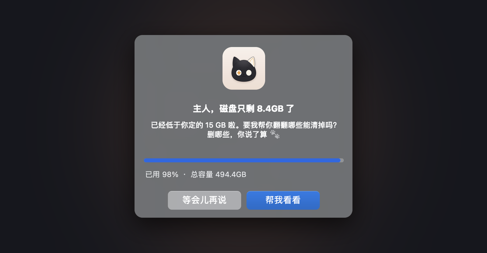

<div align="center">


# Purrge

**磁盘快满时提醒你，AI 帮你看清哪些能删，你点头了才清理。**

<sub>purr（猫咪呼噜）+ purge（清除）· by RabbittuX</sub>

<br>

  

<br>


</div>

<br>

## ✨ 它能做什么

<table>
<tr>
<td width="33%" valign="top">

**🔔 自动提醒**

后台每 30 分钟看一眼剩余空间，低于阈值才弹窗。不调用 AI、不耗额度。

</td>
<td width="33%" valign="top">

**🧠 AI 逐项判断**

缓存、安装包、大视频、旧项目……每一项都告诉你是什么、多久没用、删了有什么影响。

</td>
<td width="33%" valign="top">

**✅ 你说了算**

可重建的缓存默认勾选，你的文件默认不选。只清理你勾选并确认的，AI 没有删除权限。

</td>
</tr>
</table>

## 📸 截图

<table>
<tr>
<td width="50%" valign="top">

<p align="center"><b>空间不足时弹窗</b><br><sub>点「帮我看看」开始扫描，扫完自动打开审查页</sub></p>
</td>
<td width="50%" valign="top">

<p align="center"><b>设置面板</b><br><sub>阈值、检查频率、提醒冷却，保存立即生效</sub></p>
</td>
</tr>
<tr>
<td colspan="2">

<p align="center"><b>需要你决定的项目</b><br><sub>按类型筛选；点「打开文件夹 / 在访达中定位」先去看看里面是什么</sub></p>
</td>
</tr>
</table>

## 🚀 安装

在 Claude Code 里依次输入：

```text
/plugin marketplace add RabbittuX/purrge
/plugin install purrge@rabbittux
/purrge:setup 15
```

`15` 是阈值，剩余空间低于 15 GB 时提醒，不写就是 15。装好后不用开着 Claude Code，后台会自己运行。

<details>
<summary>不用 Claude Code 插件安装</summary>

```bash
git clone https://github.com/RabbittuX/purrge.git
cd purrge && bash install.sh 15
```

</details>

## 🐾 怎么用

| 你想做的 | 命令 | 或者直接跟 Claude 说 |
|---|---|---|
| 立即扫描清理 | `/purrge:scan` | "磁盘快满了，帮我清理一下" |
| 修改阈值 | `/purrge:config thresholdGB 20` | "阈值改成 20G" |
| 查看状态 | `/purrge:status` | "硬盘还剩多少" |
| 关闭提醒 | `/purrge:uninstall` | "关掉磁盘提醒" |

也可以直接在审查页右上角的「设置」里改。

## ⚙️ 工作方式

```text
后台检查（每 30 分钟）──低于阈值──▶ 弹窗提醒 ──帮我看看──▶ 扫描（约 10 秒）
                                                            │
     清理你勾选的 ◀──确认── 审查页面 ◀── AI 逐项判断（约 30～60 秒）
```

审查页把结果分成三组：

| 分组 | 是什么 | 默认 | 怎么处理 |
|---|---|---|---|
| 🟢 **首要清理** | 可自动重建的缓存（浏览器、npm、Xcode、剪映等） | 勾选 | 直接删除 |
| 🟡 **需要你决定** | 你的文件、重建代价大的内容 | 不选 | 移到废纸篓（可在设置里改成直接删除） |
| 🔒 **不会清理** | 保护名单、版本库、正在用的项目 | 不能选 | 只展示 |

<details>
<summary>扫描范围</summary>

- 已知缓存规则库：浏览器、npm / pip / Homebrew、Xcode、剪映、各类 IDE 等
- `~/Library/Caches` 下的大缓存目录
- Spotlight 找出的 500 MB 以上大文件
- 下载、桌面、文稿、影片等常用目录里 1 GB 以上的大文件夹

</details>

## 🔒 安全设计

- AI 只负责判断和写说明，**没有删除能力**；删除由脚本严格按你的勾选清单执行。
- 清理前逐项复核：路径还在、不在保护名单、文件扫描后没被改过，有任何一条不满足就跳过。
- 保护名单优先级最高，AI 也改不了；你的文件永远不会进「首要清理」。
- 审查页只在本机 `127.0.0.1` 打开，带一次性口令，完成或闲置 30 分钟后自动关闭。

<details>
<summary>配置文件 <code>~/.purrge/config.json</code></summary>

| 键 | 默认 | 说明 |
|---|---|---|
| `thresholdGB` | `15` | 剩余空间低于多少 GB 提醒 |
| `intervalMinutes` | `30` | 后台检查间隔（分钟） |
| `cooldownHours` | `6` | 提醒后多久内不再打扰（小时） |
| `optionalAction` | `trash` | 「需要你决定」的项目：`trash` 移到废纸篓，`delete` 直接删除 |
| `protect` | `[]` | 额外的保护路径，永不清理 |

</details>

## 📋 要求

- macOS
- Python 3.8+（没有的话运行 `xcode-select --install`）
- Claude Code 已安装并登录：AI 判断用的是你自己的额度；没有 Claude Code 也能用，会改成按规则判断
- 可选：给终端开「完全磁盘访问权限」，能扫到更多系统缓存

卸载：`/purrge:uninstall purge`，再 `/plugin uninstall purrge`。

## 📄 许可证

[PolyForm Noncommercial 1.0.0](LICENSE)，**禁止商用**。

- ✅ 个人使用、学习研究、修改、分享；学校、公益和非盈利组织也可以用
- ❌ 任何商业用途：公司用来赚钱的业务、集成进收费产品或服务、改名后售卖
- 分享或修改时请保留 LICENSE 文件和第一行的版权声明

想商用请先在 [GitHub](https://github.com/RabbittuX) 联系作者获得授权。

<div align="center">
<br>

<br>
<sub>Made with 🐾 by RabbittuX</sub>
</div>
