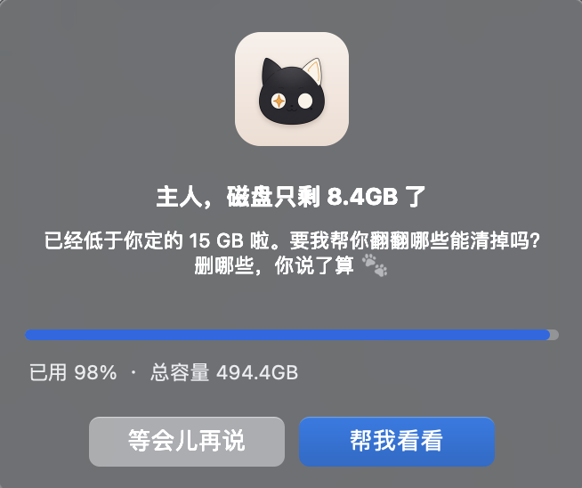
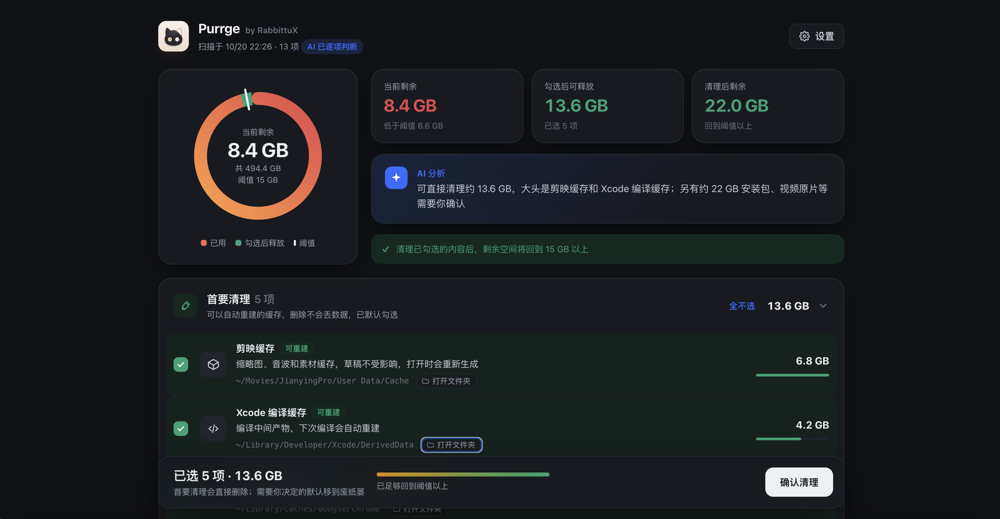
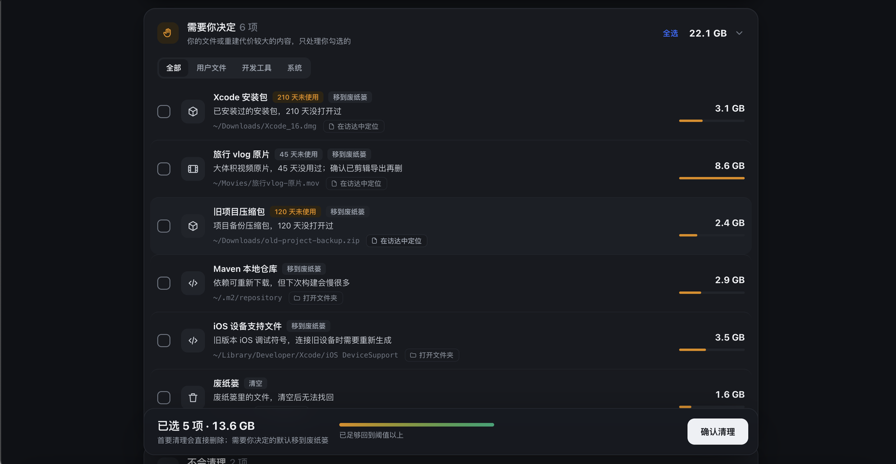
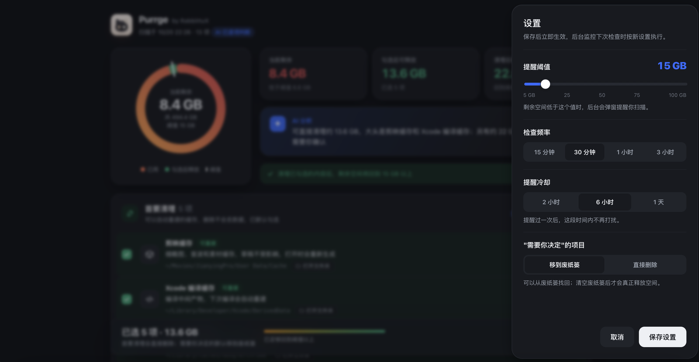

# Purrge by RabbittuX

> purr（猫咪呼噜）+ purge（清除）。

macOS 磁盘空间不足时自动提醒；扫描**可再生缓存**和**占用大的文件/文件夹**，由 AI（Claude Code）逐项判断能不能删、删了有什么影响，生成一个审查页面。**你勾选并确认之后才会清理**，不会擅自删除任何东西。

## 截图

**空间不足时弹窗提醒**：点「帮我看看」开始扫描，扫完自动打开审查页。



**审查页**：剩余空间、勾选后能释放多少、清理后剩多少，一眼看清；AI 用一句话总结这次能清什么。



**需要你决定的项目**：每项都写明是什么、多久没用、删了有什么影响；可按类型筛选，点「打开文件夹 / 在访达中定位」先去看看里面有什么。



**设置**：阈值、检查频率、提醒冷却、处理方式都在页面上改，保存后立即生效。



## 安装（Claude Code 插件，推荐）

在 Claude Code 里依次输入：

```
/plugin marketplace add RabbittuX/purrge
/plugin install purrge@rabbittux
/purrge:setup 15
```

最后一行的 `15` 是阈值：剩余空间低于 15 GB 时提醒（不写默认就是 15）。

不用插件也可以：`git clone` 后运行 `bash install.sh 15`。

## 怎么用

| 你想做的 | 在 Claude Code 里 | 或者直接说 |
|---|---|---|
| 立即扫描清理 | `/purrge:scan` | "磁盘快满了，帮我清理一下" |
| 改阈值 | `/purrge:config thresholdGB 20` | "阈值改成 20G" |
| 查看状态 | `/purrge:status` | "硬盘还剩多少" |
| 卸载提醒 | `/purrge:uninstall` | "关掉磁盘提醒" |

审查页面右上角的「⚙ 设置」也能直接拖滑块改阈值。每一项后面的「打开文件夹 / 在访达中定位」可以先去访达里看看内容再决定。

## 工作方式

1. **后台监控**（launchd，默认每 30 分钟）只检查剩余空间，不调用 AI、不耗额度；低于阈值时弹窗询问，6 小时内不重复打扰。
2. **扫描**（约 10 秒，只读）：已知缓存知识库（浏览器、npm/pip/Homebrew、Xcode、剪映、IDE 等）、`~/Library/Caches` 下的大缓存、用 Spotlight 找 500MB 以上的大文件、常用目录里 1GB 以上的大文件夹。
3. **AI 判断**（约 30～60 秒）：`claude -p` 在**禁用所有工具**的模式下只读候选清单，给每项定档并写一句说明。AI 不可用时自动改用规则判断。
4. **审查页面**：
   - 🟢 **首要清理**：可自动重建的缓存，默认勾选，**直接删除**；
   - 🟡 **需要你决定**：你的文件、重建代价大的内容，默认不选，勾选的**移到废纸篓**（可找回；设置里可改成直接删除）；
   - 🔒 **不会清理**：保护名单、版本库、正在进行的项目等，只做展示。
5. **清理**：只处理你勾选的项目；执行前逐项复核（路径仍在、不在保护名单、文件自扫描后未被修改），删不掉的（系统保护、正在使用）逐项报告。

## 安全设计

- AI 只负责"判断和写说明"，**没有删除能力**；删除由脚本按你的勾选清单精确执行。
- 保护名单（`runtime/rules/registry.json` 的 `protected` + 配置里的 `protect`）优先级最高，AI 也改不了。
- 用户文件永远不会进入"首要清理"。
- 审查页面只监听 `127.0.0.1`，带一次性口令；完成或闲置 30 分钟后自动关闭。

## 配置

`~/.purrge/config.json`：

| 键 | 默认 | 说明 |
|---|---|---|
| `thresholdGB` | 15 | 剩余空间低于多少 GB 提醒 |
| `intervalMinutes` | 30 | 后台检查间隔 |
| `cooldownHours` | 6 | 提醒后多久内不再打扰 |
| `optionalAction` | `trash` | "需要你决定"的项目：`trash` 移到废纸篓 / `delete` 直接删除 |
| `protect` | `[]` | 额外的保护路径，永不清理 |

## 要求

- macOS（使用 launchd）
- python3 3.8+（没有的话运行 `xcode-select --install`）
- Claude Code 已安装并登录（AI 判断消耗你自己的额度；没有也能用，改为规则判断）
- 可选：给终端开「完全磁盘访问权限」，能扫描到更多系统缓存目录

## 卸载

`/purrge:uninstall purge`，再 `/plugin uninstall purrge`。

## 许可证

[PolyForm Noncommercial 1.0.0](LICENSE)：**禁止商用**。

- ✅ 可以：个人使用、学习研究、修改、分享给别人，学校、公益和非盈利组织也可以用
- ❌ 不可以：用于任何商业目的，包括公司内部用来赚钱的业务、集成进收费产品或服务、改名后售卖
- 分享或修改时要保留 LICENSE 文件和第一行的版权声明

想商用请先在 [GitHub](https://github.com/RabbittuX) 联系作者获得授权。
